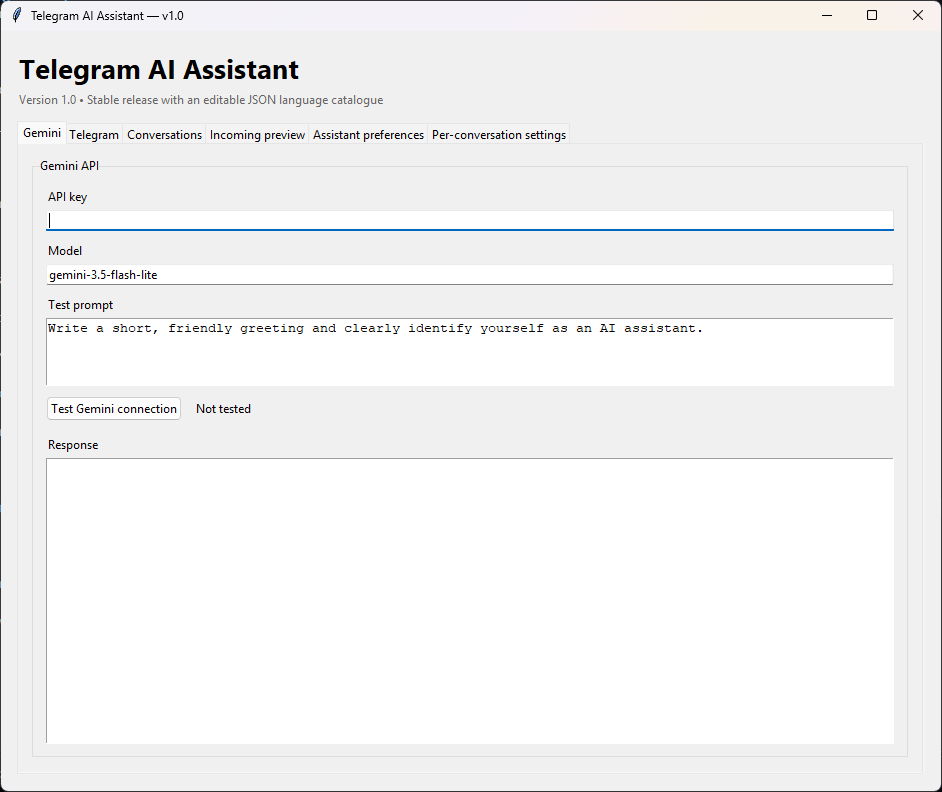
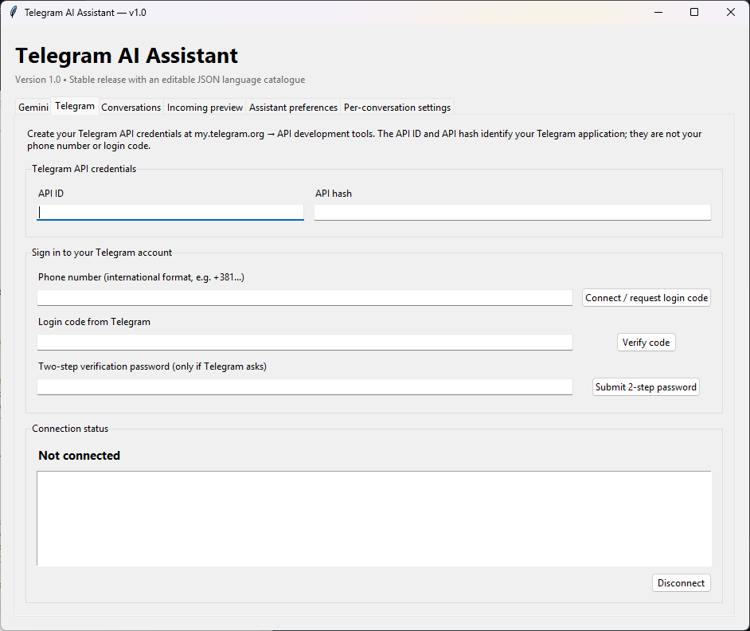
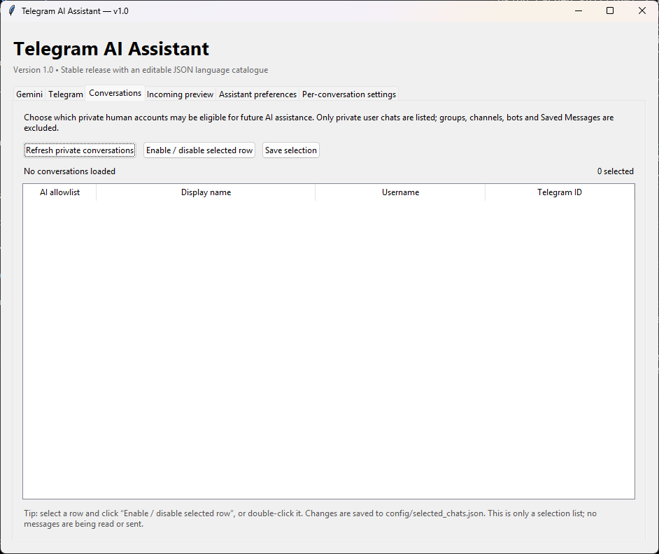
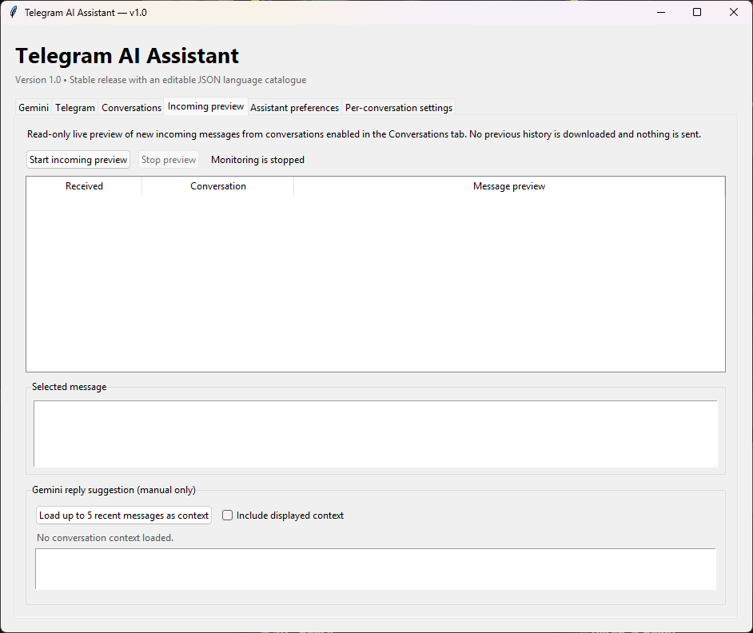
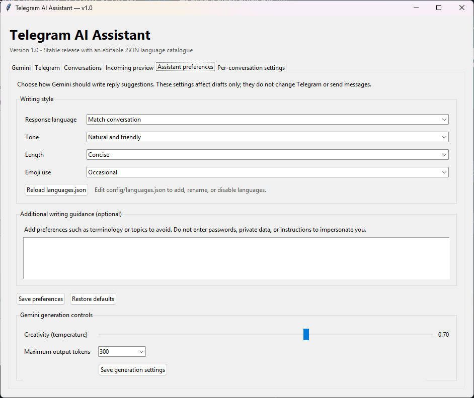
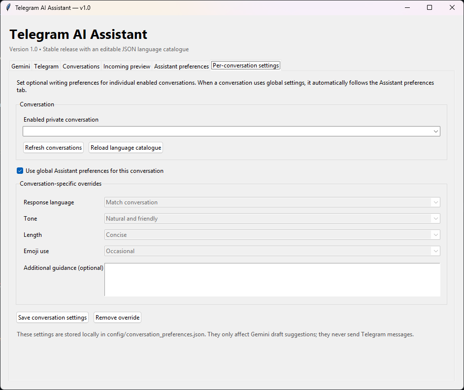

# TelegramAIreplier
A Python script dedicated to make automated responses incase you are not home, or just simply don't want to reply to someone you really don't like.

# ⚠️DISCLAIMER⚠️
## THIS PROJECT UTILIZED VIBE-CODING (AI CODING). IF YOU DO NOT LIKE VIBECODED PROJECTS THAT IS OKAY. THIS PROJECT WAS ONLY MADE FOR FUN PURPOSES AND SERVES 0 COMMERCIAL VALUE.

# Availablility
## Currently this is available for:
### ✅ Windows
### ❌ Mac
### ❌ Linux

# How to install:

Download and install Python Version 3.14.3 or above.

Install venv into the folder of your choice.

```py -3.14 -m venv .venv```

Activate the shell script.

```.\.venv\Scripts\Activate.ps1```

Make sure to update python and depencies.

```python -m pip install --upgrade pip```

Gather required files for the bot to work.

```pip install -r requirements.txt```

<!-- Basic info ends here -->

## [Latest Download Version available here!](https://github.com/SZEBIKAGamer72/TelegramAIreplier/releases/tag/Latest)

# App features

## 🤖 Gemini AI Tester
### Test Gemini's Connection to the app.
#### You need an API key for this from your google account. [(*Where can I find this?*)](#gemini-api-key)



## 🛜 Telegram Connectivity 
### You will need to make a Telegram App and gather it's API keys. [(How do I make a Telegram Bot?)](#how-to-setup-telegram-bot)



## 📖 Conversation Reader and allower 
### Control who gets to be on the AI allow list, aswell as to see their name, their @, and their ID.



## 👀 Incoming Preview of messages 
### Be in control of what the message looks like, give it context on what to add.



## 👗 Customize your AI! 
### Change the language it talks in, it's tone, the lengthness of it, aswell as how many emojis you can use.
### It's also possible to give it a custom prompt to give the user much more a freedom.
### The last setting changes how creative the AI gets, aswell it's token usage.


## 😎 Per-Person AI
### Do you have a lot of friends that have different personalities? You can configure the AI to act like how you would with them without changing the main prompt!



<!-- End of Feature List -->

# 💭 More features to be added soon...

# Gemini API Key 🔑

Head over to [Your AI Gemini API Keys](https://aistudio.google.com/api-keys), then copy it into the test box within the app.

# How to setup Telegram bot? 🤖

Head over to [my.telegram.org](https://my.telegram.org), then once you are in Select "Development Tools".

Add a name for the app, get the *App api_id* and the *App api_hash* you are pretty much done.

